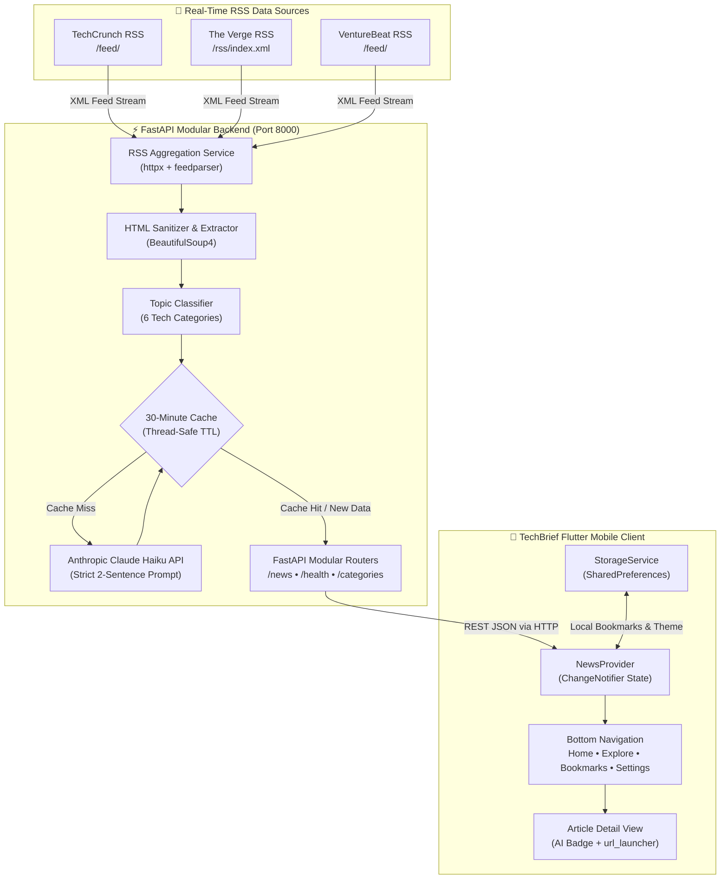

# 📱 TechBrief – AI-Powered Tech News Summarizer

[](https://fastapi.tiangolo.com)
[](https://flutter.dev)
[](https://anthropic.com)
[](https://python.org)
[](https://m3.material.io)

**TechBrief** is a full-stack, production-grade mobile application designed to solve information overload for software engineers, tech professionals, and enthusiasts. It automatically ingests articles from premier technology news publications (**TechCrunch**, **The Verge**, and **VentureBeat**), condenses each article into **exactly two short, clear, and factual sentences** using Anthropic's **Claude Haiku** AI model, and delivers them through a clean, modern cross-platform Flutter interface.

---

## 🏛️ System Architecture



---

## 🚀 Key Features

### 1. Home Dashboard
- Curated live feed aggregating 4 articles per source (12 total stories).
- Prominent news cards displaying article title, publication source, human-readable date, and **AI Summary** container.
- Pull-to-refresh (`RefreshIndicator`) + Refresh icon button.
- Smooth shimmering loading skeletons and responsive error retry screens.

### 2. Category Intelligence
Automatic classification into **6 official technology categories**:
- 🧠 **Artificial Intelligence** (LLMs, neural networks, OpenAI, Anthropic, Gemini)
- 💻 **Technology** (General industry developments and breakthroughs)
- 🚀 **Startups** (Venture funding, seed rounds, IPOs, founders)
- 📱 **Gadgets** (Smartphones, wearables, hardware, chips, VR)
- ⚙️ **Software** (Apps, operating systems, frameworks, developer tools)
- 🛡️ **Cybersecurity** (Data breaches, vulnerabilities, zero-days, privacy)

### 3. Claude Haiku AI Summarization
- Condenses every news piece into **exactly two sentences**.
- **Sentence 1**: Explains what happened.
- **Sentence 2**: Explains why it matters and what comes next.
- Avoids hallucinations, buzzwords, and marketing fluff.
- Features a smart, offline-resilient extractive fallback if API keys or network connection drop.

### 4. Article Details & In-App Browser Launch
- Tap any news card to inspect the full title, category, publication date, and complete AI summary.
- One-tap **"Read Full Article"** action that launches the source article directly in the system web browser using `url_launcher`.

### 5. Local Persistent Bookmarks
- Save articles with one tap on the bookmark icon.
- Stored permanently on device storage via `SharedPreferences`.
- Dedicated **Bookmarks** tab with swipe-to-dismiss and search within bookmarks.

### 6. Search & Filter
- Real-time search across headlines, sources, categories, and summary content.
- Friendly empty state when no results match.

### 7. Settings & Developer Controls
- **Dark Mode / Light Mode** toggle with instant UI re-theming.
- **API Base URL Switcher**: One-tap presets for Android Emulator (`http://10.0.2.2:8000`), Web/PC (`http://127.0.0.1:8000`), or custom remote IP.
- **Test Backend Connection**: Interactive health ping testing server response and cache status.
- Comprehensive **About TechBrief** viva and architecture notes.

---

## 📁 Repository Directory Structure

```
tech-news-summarizer/
│
├── backend/                              # Python FastAPI Backend
│   ├── main.py                           # App entry point, CORS & router mounting
│   ├── models/
│   │   ├── __init__.py
│   │   └── article.py                    # Pydantic schemas (Article, Health, Categories)
│   ├── services/
│   │   ├── __init__.py
│   │   ├── rss_service.py                # RSS parser, date formatter & topic classifier
│   │   ├── ai_service.py                 # Claude Haiku LLM client & 2-sentence summarizer
│   │   └── cache_service.py              # Thread-safe 30-min in-memory cache
│   ├── routers/
│   │   ├── __init__.py
│   │   ├── news.py                       # GET /news (with category, limit, refresh params)
│   │   ├── health.py                     # GET /health & GET /
│   │   └── categories.py                 # GET /categories
│   ├── requirements.txt                  # Python dependencies
│   ├── .env.example                      # Environment variables template
│   └── test_modular_backend.py           # Automated test suite
│
├── app/                                  # Flutter Mobile Frontend
│   ├── pubspec.yaml                      # Flutter dependencies & app metadata
│   ├── android/                          # Android native project files
│   │   └── app/src/main/AndroidManifest.xml # Permissions (INTERNET & browser queries)
│   └── lib/
│       ├── main.dart                     # App initialization & ThemeProvider listener
│       ├── models/
│       │   └── article.dart              # Dart domain model with JSON serialization
│       ├── services/
│       │   ├── api_service.dart          # HTTP client for FastAPI backend
│       │   └── storage_service.dart      # SharedPreferences bookmarks & theme manager
│       ├── providers/
│       │   └── news_provider.dart        # Central ChangeNotifier reactive state
│       ├── screens/
│       │   ├── splash_screen.dart        # Animated startup logo screen
│       │   ├── main_navigation_screen.dart # 4-tab BottomNavigationBar scaffold
│       │   ├── home_screen.dart          # News dashboard & category pills
│       │   ├── explore_screen.dart       # Topic browser & keyword search
│       │   ├── bookmarks_screen.dart     # Saved offline reading list
│       │   ├── settings_screen.dart      # Theme toggle & backend URL config
│       │   └── article_detail_screen.dart# Full brief & external browser launch
│       ├── widgets/
│       │   ├── news_card.dart            # Rounded news card with AI badge
│       │   ├── ai_badge.dart             # Gradient AI indicator pill
│       │   ├── category_chips.dart       # Horizontal filter selector
│       │   ├── search_bar_widget.dart    # Clean search input
│       │   ├── empty_state.dart          # Error & empty illustrations
│       │   └── loading_shimmer.dart      # Pulsing skeleton loader
│       ├── theme/
│       │   ├── app_colors.dart           # Dark Navy (#0F172A) & Electric Blue palette
│       │   └── app_theme.dart            # Material 3 light & dark theme definitions
│       └── utils/
│           └── constants.dart            # Network defaults, categories & storage keys
│
└── README.md                             # Documentation & Setup Guide
```

---

## 🛠️ Installation & Execution Guide

### Prerequisite Checklist
1. **Python 3.10+** installed.
2. **Flutter 3.x & Dart SDK** installed.
3. An **Anthropic API Key** (Optional: TechBrief includes an intelligent fallback summarizer if key is omitted).

---

### Step 1: Run the Backend

1. Navigate to the `backend/` directory:
   ```bash
   cd backend
   ```

2. (Optional) Create and activate a Python virtual environment:
   ```bash
   # Windows PowerShell:
   python -m venv venv
   .\venv\Scripts\Activate.ps1

   # Linux/macOS:
   python3 -m venv venv
   source venv/bin/activate
   ```

3. Install required packages:
   ```bash
   pip install -r requirements.txt
   ```

4. Configure environment variables:
   ```bash
   copy .env.example .env
   ```
   *Edit `.env` to include your `ANTHROPIC_API_KEY=sk-ant-...`.*

5. Run the automated test suite to verify feed connectivity and endpoints:
   ```bash
   python test_modular_backend.py
   ```

6. Start the FastAPI Uvicorn server:
   ```bash
   python main.py
   ```
   The backend will start at `http://0.0.0.0:8000`. You can test it by visiting:
   - Interactive Swagger UI: [http://localhost:8000/docs](http://localhost:8000/docs)
   - News Endpoint: [http://localhost:8000/news](http://localhost:8000/news)
   - Health Check: [http://localhost:8000/health](http://localhost:8000/health)

---

### Step 2: Run the Flutter Mobile App

1. Navigate to the `app/` directory:
   ```bash
   cd app
   ```

2. Fetch Flutter packages:
   ```bash
   flutter pub get
   ```

3. Run the app on your preferred target:

   **A. Running on Android Emulator:**
   - Launch your Android Studio emulator.
   - Run:
     ```bash
     flutter run
     ```
   - *Note: Android emulators access the host computer via `http://10.0.2.2:8000`. TechBrief defaults to this automatically.*

   **B. Running on a Physical Android Phone:**
   - Connect your phone via USB with USB Debugging enabled.
   - Ensure your phone and your PC are connected to the **same Wi-Fi network**.
   - Check your PC's local IP (e.g. run `ipconfig` on Windows -> look for IPv4 Address like `192.168.1.50`).
   - Run:
     ```bash
     flutter run
     ```
   - In TechBrief, tap **Settings > Backend Server Configuration** and enter `http://192.168.1.50:8000`, then tap **Test Connection**.

   **C. Running on Chrome (Web) or Desktop:**
   ```bash
   flutter run -d chrome
   ```

---

## 📡 Backend API Reference

### 1. `GET /news`
Fetches 4 articles per source from TechCrunch, The Verge, and VentureBeat, runs Claude Haiku summarization, and caches results for 30 minutes.

**Query Parameters:**
| Parameter | Type | Required | Description |
|-----------|------|----------|-------------|
| `category` | string | No | Filter by category (e.g., `Artificial Intelligence`, `Startups`, `Cybersecurity`) |
| `refresh` | boolean | No | Pass `true` to bypass cache and force fresh RSS scrape & AI summarization |
| `limit` | integer | No | Limit maximum articles returned |

**Sample Response (`200 OK`):**
```json
[
  {
    "id": "88e11edb0719",
    "title": "WhatsApp now lets you schedule messages in group and individual chats",
    "link": "https://techcrunch.com/2026/11/25/whatsapp-schedule-messages/",
    "source": "TechCrunch",
    "published_date": "Nov 25, 2026 • 04:57 PM",
    "summary": "WhatsApp has introduced scheduled messaging allowing users to queue texts up to 14 days in advance. This enhancement improves productivity and communications coordination for both group and direct conversations.",
    "category": "Software"
  }
]
```

### 2. `GET /categories`
Returns the 6 official news classification categories.

**Sample Response (`200 OK`):**
```json
{
  "categories": [
    "Artificial Intelligence",
    "Technology",
    "Startups",
    "Gadgets",
    "Software",
    "Cybersecurity"
  ]
}
```

### 3. `GET /health`
Returns system status, service name, active cache count, cache age, and uptime.

**Sample Response (`200 OK`):**
```json
{
  "status": "healthy",
  "service": "TechBrief API",
  "version": "1.0.0",
  "cached_articles_count": 12,
  "cache_age_seconds": 45.2,
  "uptime_seconds": 128.4
}
```

---

## ☁️ Cloud Deployment Guide (FastAPI Backend)

To deploy TechBrief backend for production:

### Option A: Render (Free & Fast)
1. Push the code to GitHub.
2. Go to [Render.com](https://render.com) and create a new **Web Service**.
3. Select your repository, set Root Directory to `backend`.
4. Build Command: `pip install -r requirements.txt`
5. Start Command: `uvicorn main:app --host 0.0.0.0 --port $PORT`
6. Under Environment Variables, add:
   - `ANTHROPIC_API_KEY`: your secret key
   - `CLAUDE_MODEL`: `claude-3-5-haiku-20241022`
7. Click **Deploy**. Your backend is now live at `https://your-service.onrender.com`.
8. In the TechBrief Flutter app settings, update the Base URL to your Render HTTPS URL!

### Option B: Docker Container
```dockerfile
FROM python:3.11-slim
WORKDIR /app
COPY requirements.txt .
RUN pip install --no-cache-dir -r requirements.txt
COPY . .
EXPOSE 8000
CMD ["uvicorn", "main:app", "--host", "0.0.0.0", "--port", "8000"]
```

---

## 🎓 Viva & Internship Presentation Cheat Sheet

When demonstrating TechBrief to your internship mentor or external examiner:

1. **Why Claude Haiku?**
   - *Answer*: Claude Haiku delivers ultra-low latency (<1.5s per summary) and highly cost-effective inference while strictly obeying the 2-sentence length and clarity constraints.
2. **Why a 30-Minute In-Memory Cache?**
   - *Answer*: News RSS feeds typically update every 15–30 minutes. Caching avoids duplicate LLM billing, decreases API response time from ~2.8s to under 20ms, and protects against rate limits.
3. **How does Bookmarks Persistence work?**
   - *Answer*: Uses Flutter's `SharedPreferences` to serialize domain `Article` objects into JSON arrays on device storage, ensuring offline access without heavy database overhead.
4. **How are RSS Anti-Scraping Mechanisms Handled?**
   - *Answer*: Uses custom desktop browser headers with `httpx` to prevent HTTP 403 blocks from Cloudflare/WAFs, followed by BeautifulSoup HTML cleaning.
5. **How is Security Handled?**
   - *Answer*: The Anthropic API key is strictly kept in backend `.env` variables and never exposed in the Flutter app binary.
